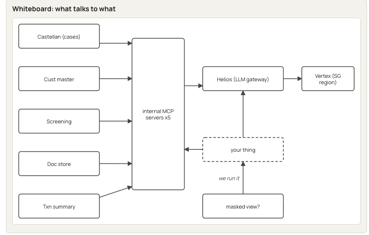

Who you talked to

Ben Tan Head of Data Platform Engineering (owns Helios, the bank's gateway to AI models). Department: Platform engineering. Reports to CTO. Your account executive named this person in the handover note.
Ben Tan

Hey, sorry, just finishing up another call. Camera's off, hope that's fine. So, you're the one going round asking about KYC and the backlog?

You

Yes - I think I have a good picture of the process and the problems - the data sources for the  case tool, the general configuration of risk triggers and alerts, the risk thresholds, and data residency and process boundaries, cloud and model access paths, regulatory cross border constratins are still open. Would yopu be able to answer these questions? If what I am asking is not relevant, please flag

Ben Tan

Yeah, that's mine to answer.

From the system: Ben shares a whiteboard with you: how the systems, his MCP servers and Helios fit together.

Ben Tan

Left side, systems of record. Castellan (the bank's case tool) up top is case history. Under it customer master, screening, the doc store, transaction summary. None of them talk to each other.

Ben Tan

These we built the last two quarters. Five internal MCP servers, one per system, read-mostly. Be a client of those.

Ben Tan

Same for the other two. Then everything model-shaped goes through Helios, the only sanctioned door in this bank.

Ben Tan

Helios fronts Vertex, Singapore region. Logging and redaction on the way through. The model itself lives Google-side.

Ben Tan

Whatever you build is this dashed box. It goes through Helios or it doesn't go.

Ben Tan

Data. There's a masked customer view that might count as lower classification. Might. Otherwise it's an exception, and exceptions here are paper. Weeks.

Ben Tan

One thing so it's said out loud: if my team can't run it without you, we won't take it. Design for that and we'll get on fine.

Ben Tan

That's the picture. Go on, ask.

You

IN this diagram - "your thing" seem to be pointing at the MCP server. dso you mean the mcp server will serv er as a context provider to the agent as well as a gateway to write the data back into the systems of record?

Ben Tan

No, read only. The MCP servers pull from customer master, screening, case history, docs, txn summary, feed into Helios for the model to use as context. Nothing writes back. Casehist especially, that's read only, a write interface into Castellan is a change request to my team and the vendor, months not weeks.

You

you said "Helios fronts Vertex, Singapore region. Logging and redaction on the way through. The model itself lives Google-side." - what models are you allowed to use - all models on vertex singapore region? If the region becomes unavailable - what is your strategy

Ben Tan

Model allowlist, I'd have to check, that's a security policy thing, not mine to say for certain. Region failover, same, I don't think we've had to think about it yet. Leo would know more, he runs Helios day to day.

You

Which components (such as customer data or prompts) are legally or policy-wise required to remain strictly within Singapore jurisdiction?

Ben Tan

Practically, anything customer identifying stays inside our GCP boundary here, that's our classification policy. Whether that's MAS law or just how we've chosen to run it, I couldn't tell you for certain, that's more a Raj or legal question.

You

"Is direct access to Anthropic allowed, or must Claude be consumed exclusively through an approved local cloud path like Helios or Vertex AI?"

Ben Tan

No, Helios is the only sanctioned path, full stop. Nothing goes direct to a model provider, everything through the gateway. That's not going to move, so plan around it.

You

From my thing to the mcp server - do I have to go through helios? Or is helios only between your internal assets and the models?

Ben Tan

Good question, actually. Your thing calls the MCP servers direct, they're internal, no need to go via Helios. Helios is only in the path when you're calling the model itself.

You

What is the authentication/authorization mechaniism for an agent to call the mcp server(s)

Ben Tan

Service account, scoped per server, that's how our internal stuff normally talks to each other. Exact setup for a new consumer like your harness, that's Leo's detail, he provisions it.

You

So there is no RBAC? All users have access to the data? Or are do you have OBO or some other mechanism in place?

Ben Tan

There's RBAC on the servers themselves, it's not a free for all. Whether your harness runs as itself or on behalf of the analyst, that's Leo's area. I'm not sure which way it goes.

You

So , as per your design, we won't be replacing castelan - but we use it to complete the account review, yes? If so, do you envision this working as a background process that updates the records on castelan or uses the data sources to build a report per customer or something different?

Ben Tan

Not replacing it, no, and nothing we build writes into it this year, I won't promise that. What it actually produces for the analyst, a draft rationale, a report, whatever, that's Grace's call.

You

Is there anything that I didn't cover here that you find important for this project? Like non functional requirements (budget per call, latency, etc, support for long term memory)?

Ben Tan

Depends what you're building, hard to say in the abstract. One thing though, anything running behind Helios goes through change control, alternate Thursdays, so factor that into timelines.

You

are there any other agents or agentic workflows currently runniong at the bank? Do you know what they have ran into it as far as issues goes?

Ben Tan

There was one, about eighteen months back, an auto rationale model on an earlier version of Helios. Piloted it with one of the floor teams for six weeks, rationales came out generic, QA overturns actually went up. Got quietly shelved.

Ben Tan

I'm sorry, I really do have to run to my next one. Let's pick this up.

Who you talked to

Ben Tan Head of Data Platform Engineering (owns Helios). Department: Platform engineering. Reports to CTO. Your account executive named this person in the handover note.
Your note on the previous conversation

Sam is the user most likely to over-trust AI output, and his session shows it. He worked a live high-risk case (PR-88301) in 38 minutes. He used KYC Assist for the source-of-funds write-up, read it once "for sense," changed a few words and submitted. When he looked at it again, he noticed "no anomalies" sat oddly next to a large commission credit. He leaves the clauses field blank because it says "optional" and "nobody's ever told me which clause goes where." He's unsure of 5.4 (source of funds) and 6.5/6.6 (ownership). He skips registry checks for individuals and doesn't always check how old a document is. He reads AI output less carefully when he's behind, and said that's probably how PR-88214 got through.

What he'd want: A checker that stops him before he submits, not a drafting tool and not a side panel he has to remember to open. In his words: "A draft paragraph still reads fine even when it's wrong, that's sort of the problem." This supports an evidence-and-validation agent over a rationale writer, though Grace and Nora make that call.

His live case is a ready-made test case. Gaps visible on screen:

Stale document: The employer letter is dated 5 June and seems to be past the 90-day validity window. Today's date isn't shown on screen, so this needs confirming.
Missing evidence: The commission is paid through a Malaysian affiliate, which is cross-border income on a high-risk customer, but the commission statement has been outstanding for 20 days. He closed anyway because the RM said not to hold the file and "QA never asks." QA had emailed an evidence reminder on 28 August.
New screening hit on his employer: It was referred to the RM, and the registry extract for the employer dates from 2023.
Ownership change not checked: A family holding company was added in February with no registry extract. He skipped 6.6 because the customer is an individual.
No clauses named, which is exactly what MAS flagged.

Ben Tan

Hey. Back again. Didn't get to finish on that pilot from last time, sorry, had to run. What's on your mind this time?

You

I have a series of follow up questions for you. Ok to ask? If my questions are relevant or not under your purview, feel free to let me know

Ben Tan

Sure, go ahead. If it's not mine I'll say so and point you at who it is.

You

Leo says Helios does no redaction, only pass-through and metadata logging. You described redaction. Which is it?

Ben Tan

Leo's the one who'd know that in detail, he runs it day to day. I think I meant the metadata logging, who called what, when. If I said redaction of content, that's probably not right, I'd check with him.

You

Claude has regional endpoints on Vertex in asia-southeast1. Would adding it go on the existing GCP commitment, or does it need a new vendor line? What does your side of the approval involve, and how long does it take? (Deferred by Leo and Anna.)

Ben Tan

Vendor line and commitment, that's Anna, not me. On our side any new model behind Helios goes through change control, the board sits alternate Thursdays, and I couldn't tell you how long before that beyond 'next one's on a Thursday'.

You

Who runs security review? Can you introduce me, the way you introduced Leo?

Ben Tan

That's us, actually, my team does that sign-off, there isn't a separate security person to send you to. For a new model it's not really a sandbox form, it goes to change control, the Thursday board I mentioned.

You

So if I request Claude models to be on the allowed list - you can add it to the docket for the next change control board meeting"?

Ben Tan

I can't just stick something on the docket based on a conversation. It needs a case behind it and it usually comes in through the plan once that's agreed.

You

Identity: one agent service account with the analyst ID passed as data, or the analyst's own permissions enforced? Leo says it's partly your call and partly Security's.

Ben Tan

That's Leo's level of detail. My instinct is service account with the analyst ID logged alongside, but don't quote me, he'd know what we actually support.

You

The data exception for unmasked customer data: who approves it, what does the form need, and how many weeks realistically?

Ben Tan

Weeks to months is the honest answer, I don't have a tighter number than that. Who exactly signs it, I'd have to check, that's not something I've run personally.

You

Will the masked customer view include related parties and ownership fields? The 6.5/6.6 checks need them, and Leo says their absence is what broke the pilot.

Ben Tan

I didn't know that's what tripped up the old pilot, that's useful to hear. I'm not sure what's in the masked view down to that level. That's Leo's territory.

You

Is there any route to ACRA data for the agent, an existing integration or a new MCP server? If not, can we agree the agent only flags stale registry extracts?

Ben Tan

Not that I know of, no integration to a registry like that. If there isn't one, flagging stale extracts sounds sensible to me, but that's really a call for whoever owns the review requirements, not me.

You

Where does the POC run? Is there a sandbox inside the GCP boundary that can reach the MCP servers, and is it covered by the current letter?

Ben Tan

Sandbox access on the letter is fine, that's covered. It'd sit inside our GCP project, reaching the MCP servers, but it doesn't exist yet, the form hasn't gone in. About a week once it does.

You

Change control: what does a submission for the alternate-Thursday window need, and does a prompt change count as a change?

Ben Tan

I'd have to check whether a prompt change on its own triggers it, that's a Leo question really, he's closer to what's been logged as a change before. For what the submission needs, also his detail, sorry, I don't want to guess wrong on that one.

You

Vertex Singapore SLA and the failover position. Leo says calls just fail and pointed to you or the GCP account rep.

Ben Tan

We don't have a separate failover region set up for this, far as I know. I'd leave it at fail and retry unless Leo's seen something different. The SLA numbers are with the account rep.

You

The risk scoring formula and weightings: Nora says your team runs the vendor module, and Grace and Raj don't know the formula.

Ben Tan

We host the module, we don't own the formula, that's the vendor's. I've never seen the weightings written down anywhere on our side either.

Ben Tan

I'm sorry, I really do have to run to my next one. Let's pick this up.

Who you are talking to

Ben Tan Head of Data Platform Engineering (owns Helios). Department: Platform engineering. Reports to CTO. Your account executive named this person in the handover note.
Ben Tan

Hey. Back again. What's on your mind this time?

You

Change control: what does a submission for the alternate-Thursday window need, and does a prompt change count as a change?

Ben Tan

You need a paper on it, basically a case, what's changing and why, goes to the board alternate Thursdays. Whether a prompt change needs its own submission, I'm not sure. That might be a Leo question, he runs the actual process day to day.

You

Vertex Singapore SLA and the failover position. Leo says calls just fail and pointed to you or the GCP account rep.

Ben Tan

Same as I said before, we don't have a separate failover region for this. If it drops, it drops, and you retry. Anything beyond that, SLA numbers and so on, that's really the GCP account rep, not us.

You

The risk scoring formula and weightings: Nora says your team runs the vendor module, and Grace and Raj don't know the formula.

Ben Tan

Same as last time, that one's the vendor's. We host the module, we don't own the formula or the weightings. Nobody's shown me those written down on our side.

You

or your team to run this without us, what do you need delivered: runbooks, monitoring, evaluation harness, on-call?

Ben Tan

Runbook and monitoring for sure, and someone on our side needs to actually understand the harness, not just watch a dashboard. On-call sits with my team either way, we don't push that out. Evaluation harness, that's new territory for us, we'd need to see what it looks like before I can say what we need from you on it.

You

Where can our audit and evaluation trail live, given Helios doesn't keep prompt content?

Ben Tan

Helios won't give you that, it's metadata only, that's deliberate. If you need the reasoning kept, your harness has to log it itself, somewhere inside our environment, and that log becomes something change control looks at too.

You

What happened after the shelved pilot? Was there a retrospective we can read?

Ben Tan

Not that I know of, nothing written up formally. It was mostly a conversation at the time. Nora's team pushed back, overturns went up, we just quietly stopped. If anyone kept notes it'd be Nora.