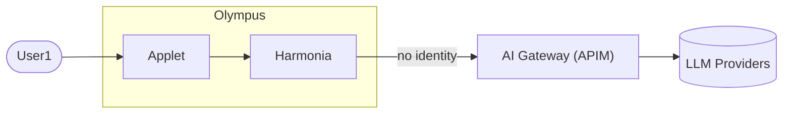
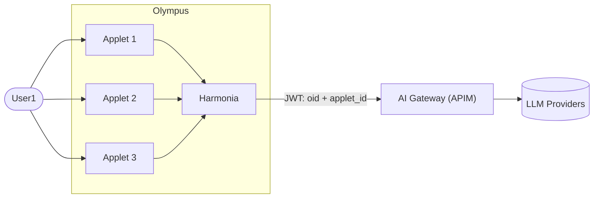
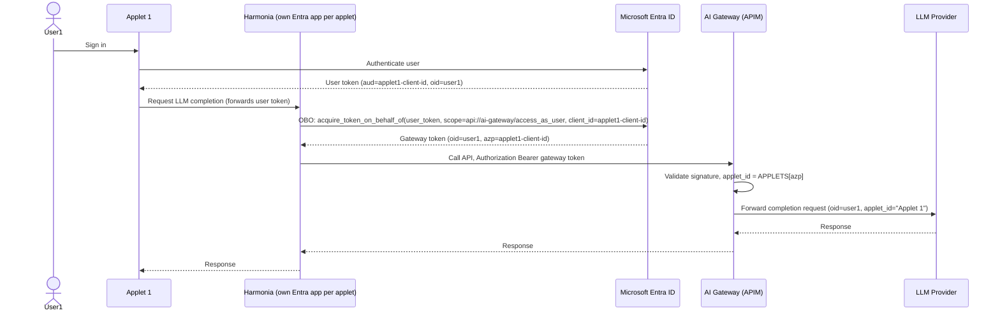
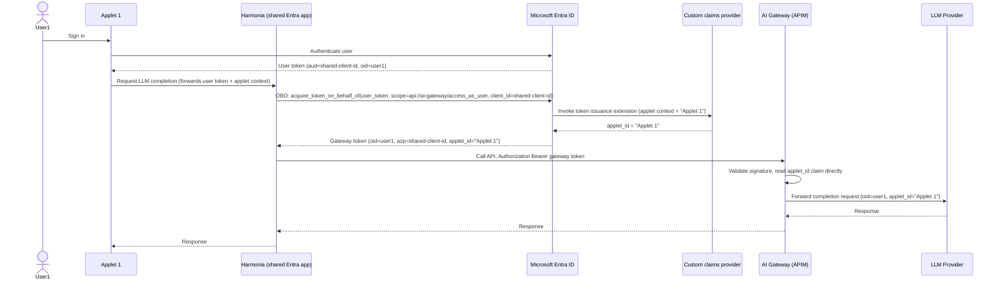

# End-to-End User Identity Propagation (On-Behalf-Of Flow)

## Overview

**Olympus** is the platform; Applet 1, Applet 2, and Applet 3 are applications that live inside it.
When an applet needs an LLM completion, it does not call a model provider directly — it goes through
**Harmonia**, the Olympus component responsible for all outbound LLM calls.

Today those calls bypass identity: Harmonia talks to model providers without carrying who the user was
or which applet triggered the request. The proposal is for Harmonia to call the **AI Gateway (APIM)**
instead, presenting a JWT that carries both **who** the user is (`oid`) and **which applet** triggered
the call (`applet_id`). The gateway then forwards the request to the approved LLM providers, with full
attribution.

Harmonia obtains that JWT via the OAuth2 On-Behalf-Of (OBO) flow. There are two ways to get the applet
identity onto the token:

- **Option A — dedicated Entra app registration per applet.** Harmonia performs the OBO exchange using
  each applet's own `client_id`/`client_secret`, so the applet identity comes for free from the standard
  `azp` (authorized party) claim.
- **Option B — one shared Entra app registration.** Harmonia uses a single registration for every
  applet, so `azp` is always the same; a trusted claims provider must stamp a custom `applet_id` claim
  onto the token during issuance instead.

## Architecture

### Current state



### Target state



## Option A — dedicated Entra registration per applet

Each applet is its own Entra app registration, with its own `client_id`/`client_secret`. The gateway
derives `applet_id` from the standard `azp` claim, using a lookup table it maintains itself. No custom
claim or trusted issuer is needed.

### App registrations (one per applet)

```json
{
  "applet": "Applet 1",
  "entra_app_registration": {
    "tenant_id": "<tenant-id>",
    "client_id": "<applet1-client-id>",
    "client_secret": "<stored in Applet 1's key vault>",
    "requested_scopes": ["api://ai-gateway/access_as_user"]
  }
}
```

```json
{
  "applet": "Applet 2",
  "entra_app_registration": {
    "tenant_id": "<tenant-id>",
    "client_id": "<applet2-client-id>",
    "client_secret": "<stored in Applet 2's key vault>",
    "requested_scopes": ["api://ai-gateway/access_as_user"]
  }
}
```

### Sequence diagram



Harmonia repeats the same exchange for Applet 2 and Applet 3 requests, using each applet's own
`client_id`/`client_secret`.

### Resulting token claims (differ per applet)

```json
{
  "oid": "user1",
  "preferred_username": "user1@company.com",
  "azp": "applet1-client-id",
  "aud": "api://ai-gateway"
}
```

```json
{
  "oid": "user1",
  "preferred_username": "user1@company.com",
  "azp": "applet2-client-id",
  "aud": "api://ai-gateway"
}
```

### Client side — Harmonia acquires the gateway token (OBO) for an Applet 1 request

```python
from msal import ConfidentialClientApplication

# Applet 1's own Entra App Registration; Harmonia holds one credential set per applet
TENANT_ID = "<tenant-id>"
CLIENT_ID = "<applet1-client-id>"
CLIENT_SECRET = "<applet1-client-secret>"

# User token forwarded by Applet 1 along with its LLM completion request
USER_ACCESS_TOKEN = applet_request.user_token

app = ConfidentialClientApplication(
    client_id=CLIENT_ID,
    client_credential=CLIENT_SECRET,
    authority=f"https://login.microsoftonline.com/{TENANT_ID}",
)

result = app.acquire_token_on_behalf_of(
    user_assertion=USER_ACCESS_TOKEN,
    scopes=["api://ai-gateway/access_as_user"],
)

gateway_token = result["access_token"]
```

### Server side — AI Gateway validates the token and resolves the applet

```python
import jwt
from jwt import PyJWKClient

TENANT_ID = "<tenant-id>"
AUDIENCE = "api://ai-gateway"
JWKS_URL = f"https://login.microsoftonline.com/{TENANT_ID}/discovery/v2.0/keys"
jwk_client = PyJWKClient(JWKS_URL)

# Maintained by the AI Gateway team
APPLETS = {
    "applet1-client-id": "Applet 1",
    "applet2-client-id": "Applet 2",
    "applet3-client-id": "Applet 3",
}

def resolve_identity(bearer_token: str) -> dict:
    signing_key = jwk_client.get_signing_key_from_jwt(bearer_token)
    claims = jwt.decode(
        bearer_token,
        signing_key.key,
        algorithms=["RS256"],
        audience=AUDIENCE,
        issuer=f"https://login.microsoftonline.com/{TENANT_ID}/v2.0",
    )
    return {
        "oid": claims["oid"],
        "applet_id": APPLETS[claims["azp"]],  # azp is set by Entra, not by the applet
    }
```

## Option B — one shared Entra registration with a trusted custom claim

All applets authenticate through a single Entra app registration, so `azp` is identical for every
applet and cannot distinguish them. A trusted claims provider (an Entra custom authentication
extension) must stamp `applet_id` onto the token during issuance, based on which applet initiated the
sign-in.

### App registration (shared)

```json
{
  "entra_app_registration": {
    "tenant_id": "<tenant-id>",
    "client_id": "<shared-client-id>",
    "client_secret": "<stored centrally by the AI Gateway team>",
    "requested_scopes": ["api://ai-gateway/access_as_user"]
  },
  "shared_by": ["Applet 1", "Applet 2", "Applet 3"]
}
```

### Sequence diagram



### Resulting token claims (same azp, different applet_id)

```json
{
  "oid": "user1",
  "azp": "shared-client-id",
  "aud": "api://ai-gateway",
  "applet_id": "Applet 1"
}
```

```json
{
  "oid": "user1",
  "azp": "shared-client-id",
  "aud": "api://ai-gateway",
  "applet_id": "Applet 2"
}
```

### Client side — Harmonia acquires the gateway token (OBO) for an Applet 1 request

```python
from msal import ConfidentialClientApplication

# Shared across all applets; Harmonia holds a single credential set
TENANT_ID = "<tenant-id>"
CLIENT_ID = "<shared-client-id>"
CLIENT_SECRET = "<shared-client-secret>"

# User token forwarded by Applet 1 along with its LLM completion request
USER_ACCESS_TOKEN = applet_request.user_token

app = ConfidentialClientApplication(
    client_id=CLIENT_ID,
    client_credential=CLIENT_SECRET,
    authority=f"https://login.microsoftonline.com/{TENANT_ID}",
)

# The custom claims provider is configured in Entra to stamp applet_id="Applet 1"
# based on the applet context Harmonia passes in; the call itself is unchanged
# for every applet.
result = app.acquire_token_on_behalf_of(
    user_assertion=USER_ACCESS_TOKEN,
    scopes=["api://ai-gateway/access_as_user"],
)

gateway_token = result["access_token"]
```

### Server side — AI Gateway validates the token and reads the custom claim

```python
import jwt
from jwt import PyJWKClient

TENANT_ID = "<tenant-id>"
AUDIENCE = "api://ai-gateway"
JWKS_URL = f"https://login.microsoftonline.com/{TENANT_ID}/discovery/v2.0/keys"
jwk_client = PyJWKClient(JWKS_URL)

def resolve_identity(bearer_token: str) -> dict:
    signing_key = jwk_client.get_signing_key_from_jwt(bearer_token)
    claims = jwt.decode(
        bearer_token,
        signing_key.key,
        algorithms=["RS256"],
        audience=AUDIENCE,
        issuer=f"https://login.microsoftonline.com/{TENANT_ID}/v2.0",
    )
    return {
        "oid": claims["oid"],
        "applet_id": claims["applet_id"],  # stamped by the trusted claims provider, not derived
    }
```

## Comparison

| | Option A — dedicated registration | Option B — shared registration |
|---|---|---|
| Applet identity source | Native `azp` claim | Custom `applet_id` claim |
| Trust model | Strong — Entra itself asserts `azp` | Requires a trusted claims provider and governance over who can stamp claims |
| Onboarding a new applet | New Entra app registration + gateway lookup entry | No new registration; configure the claims provider mapping |
| Operational overhead | One registration per applet to manage | One registration total, plus the claims provider to maintain |

## Recommendation

Adopt an explicit gateway contract requiring both `oid` and `applet_id` on every call. Use **Option A**
when identity assurance is the priority and the number of applets is manageable. Use **Option B** when
reducing app registration management overhead matters more, and the team is willing to operate a
trusted custom claim issuance process. 
